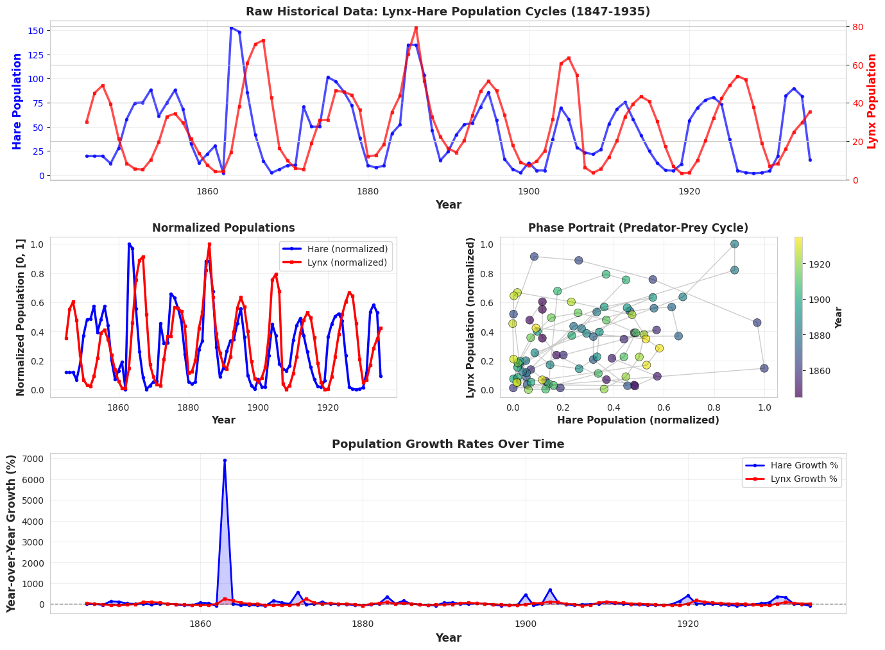
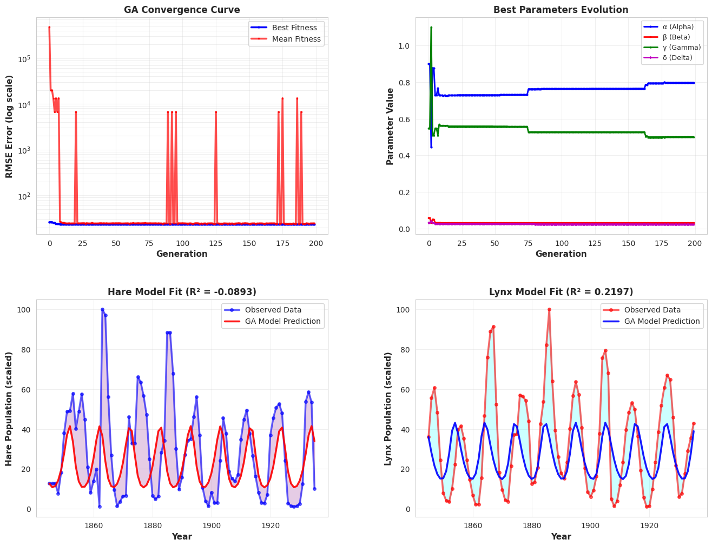
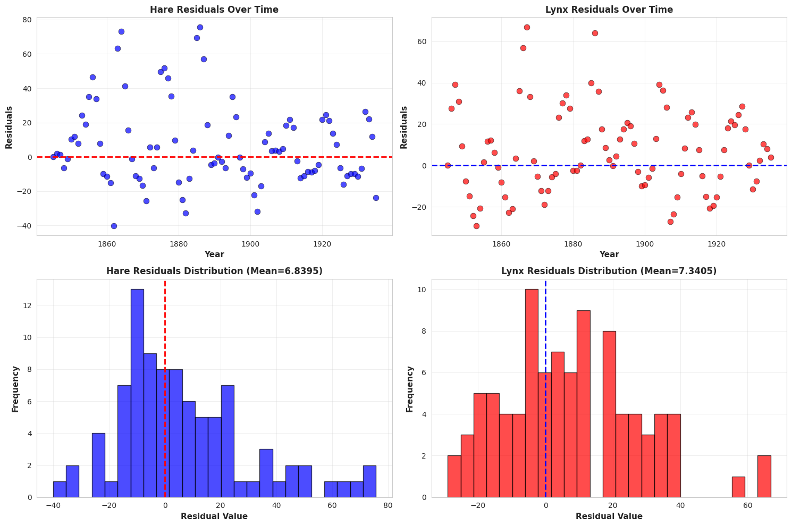
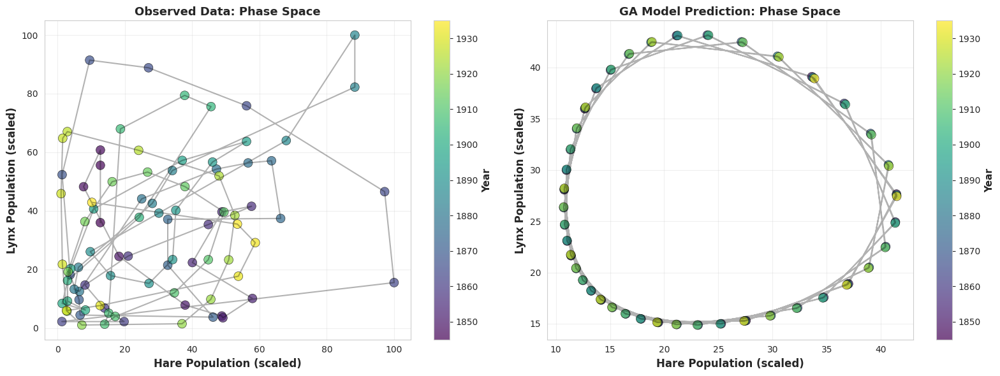

# Lynx-Hare Population Fitting with a Genetic Algorithm

This project uses a genetic algorithm to estimate the parameters of the Lotka-Volterra predator-prey model, using the Hudson's Bay Company lynx and hare data (1845-1935).

Everything is in one notebook: `Lynx_Hare_GA_Project.ipynb`.

The GA runs and converges, results and reasons are explained below.

## The idea

The Lotka-Volterra equations describe two interacting populations:

```
dH/dt =  alpha * H  -  beta * H * L
dL/dt = -gamma * L  +  delta * H * L
```

- `H` hare (prey), `L` lynx (predator)
- `alpha`: hare growth rate when there are no lynx
- `beta`: how strongly lynx predation reduces hares
- `gamma`: lynx die-off rate when there are no hares
- `delta`: how efficiently eaten hares turn into new lynx

Given a time series of both populations, the job is to find the `(alpha, beta, gamma, delta)` whose simulated curves are closest to the observed ones. The error surface is non-convex and the ODE has to be solved for every candidate, which is a reasonable case for a population-based search.

## Data

91 yearly records, 1845 to 1935, loaded straight from a public URL inside the notebook:

```
http://people.whitman.edu/~hundledr/courses/M250F03/LynxHare.txt
```

Columns are `Year`, `Hare`, `Lynx`. If that link ever dies, grab the dataset from another mirror and change the `read_csv` line in the notebook.



## Preprocessing

- Each series is min-max scaled to [0, 1], then stretched to [1, 100] so the populations stay positive and the parameter ranges are easy to reason about.
- Time is shifted so year 0 is 1845.
- Log values and year-over-year growth rates are also computed for the EDA plots (they are not used in the fit).
- The ODE is started from the first observed (scaled) values and integrated with `scipy.integrate.odeint` over all 91 time points.

Because of the scaling, the fitted parameters describe the scaled populations, not raw pelt counts.

## The genetic algorithm

Written from scratch with NumPy, in the `GeneticAlgorithm` class.

| Part | What I used |
|---|---|
| Individual | 4 real numbers `[alpha, beta, gamma, delta]` |
| Population size | 150 |
| Generations | 200 |
| Selection | Tournament, size 5 |
| Crossover | Uniform, applied with probability 0.85 |
| Mutation | Gaussian, per-gene probability 0.15, std = 10% of that parameter's range, clipped to bounds |
| Elitism | Top 10% copied unchanged |
| Fitness | `0.5 * RMSE(hare) + 0.5 * RMSE(lynx)` on the scaled data; lower is better |

Search bounds:

| Parameter | Lower | Upper |
|---|---|---|
| alpha | 0.4 | 1.2 |
| beta | 0.03 | 0.12 |
| gamma | 0.5 | 2.0 |
| delta | 0.005 | 0.05 |

If the ODE solver blows up or throws, the individual gets a penalty fitness of `1e6`, which is why generation 0 shows a huge mean fitness.

## Results

From the run saved in the notebook. The seed is not fixed, so every run differs a little: a second run gave R² of -0.0893 (hare) and 0.2197 (lynx), and the figures below are from that second run.

| Quantity | Value |
|---|---|
| alpha | 0.7985 |
| beta | 0.0300 |
| gamma | 0.5000 |
| delta | 0.0218 |
| Final fitness (mean RMSE) | 23.16 |
| R² hare | -0.09 (-0.0893 in the latest run) |
| R² lynx | 0.22 (0.2197 in the latest run) |
| MAPE hare | 185.98% |
| MAPE lynx | 147.85% |

Convergence was quick: best fitness went from 26.5 at generation 0 to about 23.35 by generation 30, then crept down to 23.16 by the end.



Residuals and phase space:





What the figures show:

- In the convergence plot, the best fitness (blue) is flat almost from the start, while the mean (red) has occasional spikes to around 10^4. Those are single individuals that hit the `1e6` penalty and get averaged into the mean (1e6 / 150 is roughly 6,700), not a sign of the search going unstable.
- The best parameters barely move after about generation 75; later gains are small nudges in `alpha` and `gamma`.
- The residuals are not centred on zero (means of about 6.8 for hare and 7.3 for lynx). The model sits below the data more often than above it, and the hare residuals are skewed, with a long tail from the huge peaks around 1863 and 1885.
- In the phase portrait, the model draws one clean closed loop, while the real data wanders all over the plane. That is the core mismatch.
- The growth-rate panel in the EDA figure is dominated by one spike of roughly 7,000% around 1863, when the hare count jumps from almost nothing. It makes the rest of that panel hard to read. The EDA title also says 1847-1935 although the data starts in 1845.

### How to read this honestly

- An R² below zero for hares means the model does worse than just predicting the mean.
- `beta` and `gamma` ended up exactly on their lower bounds. That usually means the optimizer wanted to go lower but was not allowed to, so the "best" answer here is partly an artifact of my bounds.
- The model only has to hit one initial condition and then run 90 years untouched. Classic Lotka-Volterra has neutrally stable cycles with a fixed amplitude and period set by the initial state. The real data has irregular amplitudes (roughly 9-10 year cycle, but peaks vary a lot), so a long free-running simulation drifts out of phase with the data quickly.
- MAPE is inflated by the scaling: values near 1 on the [1, 100] scale make percentage errors blow up.

## Things I'd change next

- Widen or remove the bounds on `beta` and `gamma` and see where the optimizer actually goes.
- Fix the mismatch between the bounds inside `fitness_function` (alpha 0.3-1.0, beta 0.02-0.15, gamma 0.4-1.5, delta 0.005-0.05) and the GA's own bounds (listed above). Right now the fitness check is a second, different set of limits.
- Also fit the initial conditions `H0, L0` as parameters instead of pinning them to the first data point.
- Fit short windows (one cycle at a time) or use a model with a carrying capacity, such as logistic prey growth, which tends to match this dataset better.
- Compare against `scipy.optimize.least_squares` or differential evolution as a baseline.
- Set a random seed and average over several runs.

## Running it

```bash
git clone https://github.com/Termdamp/Lynx_Hare_GA_Project
cd Lynx_Hare_GA_Project

python -m venv .venv
source .venv/bin/activate        # Windows: .venv\Scripts\activate
pip install -r requirements.txt

jupyter notebook Lynx_Hare_GA_Project.ipynb
```

Then run all cells top to bottom. The GA cell takes a little while since it solves the ODE 150 times per generation. The notebook downloads the dataset, so you need an internet connection. It also saves its four figures (`01_eda_analysis.png` through `04_phase_portrait.png`) into the working directory.

Heads up: the notebook calls `pd.read_csv(..., delim_whitespace=True)`, which is deprecated in recent pandas versions. If you get a warning or error, replace it with `sep=r"\s+"`.

## Repo layout

```
.
├── Lynx_Hare_GA_Project.ipynb   # full pipeline: load, EDA, GA, plots
├── images/                      # figures from the saved run
├── requirements.txt
├── LICENSE
└── README.md
```

## References

- Lotka, A. J. (1925). *Elements of Physical Biology*.
- Volterra, V. (1926). Variazioni e fluttuazioni del numero d'individui in specie animali conviventi.
- Strogatz, S. H. *Nonlinear Dynamics and Chaos*.

## License

MIT, see [LICENSE](LICENSE).
